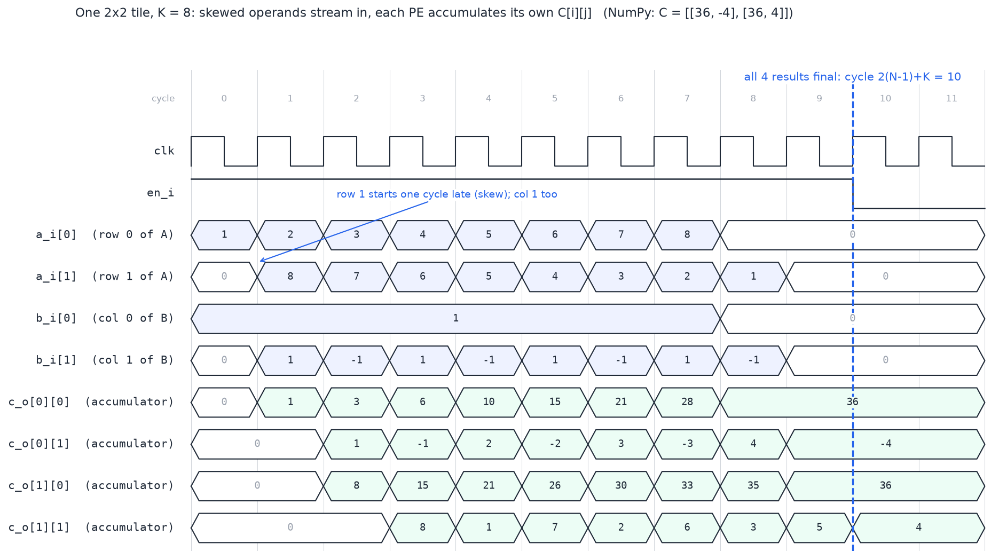

# tensor-mac

A parameterized **INT8 systolic-array matrix-multiply accelerator** in SystemVerilog, verified three ways:
constrained-random cocotb regression against NumPy, an unbounded formal proof with SymbiYosys, and mutation
testing to show the tests catch real bugs. Open-source tools only; one `make` reproduces every result below.

## Results

| Block | What it is | Verification | Result |
|---|---|---|---|
| `mac` | signed DW x DW multiply + ACC_W accumulator, sync clear and enable | SV testbench (signed corners, accumulate over K, clear while enabled) | 17 / 17 checks |
| | | cocotb, constrained random vs an independent Python model | 10,000 checks, 0 mismatches |
| | | formal (SymbiYosys + z3): accumulator can never overflow | proven for all time (k-induction) |
| `pe` | output-stationary processing element: one MAC + registered A and B relay | cocotb vs a two-chain reference model | 10,000 checks, 0 mismatches |
| `systolic_array` | N x N grid of PEs, A flows east, B flows south | cocotb vs NumPy `A @ B`, 500 random INT8 tiles | 2,000 checks at N=2, 4,500 at N=3, 0 mismatches |

**Do the tests have teeth?** Three deliberately broken MACs (swapped clear/enable priority, `signed` removed,
accumulate feedback deleted) were each caught by the regression. Narrowing the accumulator by one bit makes the
formal proof fail with the exact worst-case trace: eight back-to-back (-128) x (-128) products.

## One tile in the waveform



Row 1 of A and column 1 of B enter one cycle late, so each PE(i,j) starts at cycle i+j. PE(0,0) finishes at
cycle 8; the far corner PE(1,1) finishes last, at cycle 2(N-1)+K = 10.

## Design

```
            B columns (skewed, one per column)
                 |          |
                 v          v
 A rows   --> [PE 0,0] --> [PE 0,1] -->
 (skewed)        |          |
          --> [PE 1,0] --> [PE 1,1] -->
                 |          |
                 v          v
 each PE: acc <= acc + a*b, then passes a east and b south one cycle later
```

- **Operation:** C = A x B, one N x N tile of C per pass, K multiply-accumulates per output.
- **Dataflow: output-stationary.** Each PE keeps its own C[i][j]; only 8-bit operands move between PEs, the wide
  accumulator never leaves its cell. Weight-stationary is the planned comparison (see roadmap).
- **Accumulator width from the worst case, not a guess:** the largest signed product is 2^(2DW-2), K of them need
  `ACC_W = 2*DW + clog2(K)` bits (19 bits at DW=8, K=8). It is a `localparam` so it cannot be set too small.
- **Latency:** PE(i,j) starts at cycle i+j; the tile is done at 2(N-1)+K (wavefront fill plus accumulation depth).
- **No ready/valid inside the array:** it is statically scheduled on one global enable, so no cell can stall on its
  own. Flow control belongs at the array edge.

Full spec with the port table and the control FSM cycle contract: [`docs/SPEC.md`](docs/SPEC.md).

## Bugs found along the way

- **N drivers on one net, lint still clean.** The B-edge `assign` sat inside the row loop, so every row drove the
  same wire. Verilator stayed quiet because the drivers agreed. Fixed with its own column-only loop.
- **A latency that only worked at N=2.** A hand-counted `+1` drain matched 2(N-1)+K only when N=2. Re-running at
  N=3 exposed it; the test now uses the formula.
- **True but not inductive.** "Shadow accumulator equals the real one" passed the base case but failed induction on an
  unreachable state. Adding a magnitude-vs-depth invariant made the proof close.
- **`-2**14` is `(-2)**14`.** Unary minus binds tighter than `**`, which turned the formal lower bound positive.

## Quick start

Tools: Icarus Verilog, Verilator, Yosys, SymbiYosys, z3 (all in the [OSS CAD Suite](https://github.com/YosysHQ/oss-cad-suite-build)),
plus Python 3 with the pinned packages.

```bash
git clone https://github.com/Jazz0009/tensor-mac.git && cd tensor-mac
pip install -r requirements.txt
make            # lint + SV testbench + 3 cocotb regressions + formal proof
```

Single steps: `make lint`, `make sim`, `make cocotb`, `make formal`, `make clean`.
Tested on Ubuntu with Icarus 12.0, Verilator 5.032, Yosys 0.52, SymbiYosys 0.66, z3 4.13, Python 3.13, cocotb 2.0.1.

## Layout

```
rtl/      mac.sv  pe.sv  systolic_array.sv
tb/       mac_tb.sv                         SystemVerilog self-checking testbench
dv/       test_*.py  sim.py                 cocotb regressions and runner
formal/   mac.sby                           SymbiYosys proof job
docs/     SPEC.md  waveform_tile.png
```

## Roadmap

- [x] MAC, processing element, N x N array, each verified (above)
- [ ] Control FSM and operand feeders (cycle contract written in the spec)
- [ ] Top level with ready/valid streams, random backpressure, measured utilization
- [ ] FPGA implementation on Artix-7 (xc7a35t) in Vivado: LUT, DSP, Fmax and timing report
- [ ] UVM environment for the MAC; formal checks on the controller
- [ ] Weight-stationary variant, measured against output-stationary on the same tests

## License

MIT
